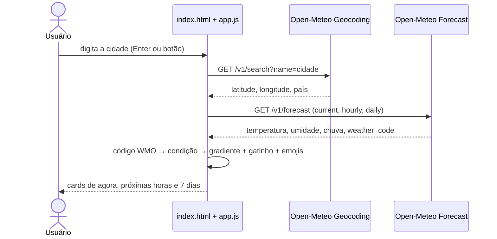

<div align="center">

# 🌤️ Meteora

Previsão do tempo em **HTML, CSS e JavaScript puro**, com dados em tempo real da API Open-Meteo, visual *glassmorphism* e tema escuro automático.


**[🌐 Abrir o Meteora](https://day-barbosa.github.io/Meteora/)**

</div>

---

<!-- 📸 MÍDIA: grave um GIF (~10 s) buscando duas cidades com climas diferentes (ex.: "Salvador" e "Gramado") para mostrar a troca de gradiente e do gatinho. Salve em docs/demo.gif e troque este comentário por:
<p align="center"></p>
-->

## 💡 Sobre o projeto

Uma consulta rápida de clima, **sem framework e sem chave de API**: a pessoa digita uma cidade e vê a condição atual, as próximas 24 horas e os próximos 7 dias. O fundo e a ilustração de gatinho mudam conforme o clima, e o tema escuro liga sozinho à noite. O objetivo foi praticar consumo de APIs REST com `fetch`/`async-await` e manipulação do DOM sem bibliotecas.

## 🏗️ Arquitetura e decisões técnicas



| Decisão | Por quê |
|---|---|
| **JavaScript puro** | Foco nos fundamentos: `fetch`, `async/await`, `URLSearchParams` e DOM, sem framework. |
| **Open-Meteo** | API gratuita e sem chave, então o projeto roda direto no navegador e no GitHub Pages sem expor segredos. |
| **Duas chamadas encadeadas** | A geocodificação transforma o nome da cidade em coordenadas, e a previsão usa essas coordenadas. |
| **Tabela de códigos WMO** | Um só mapeamento converte o `weather_code` em condição (sol, chuva, neve, vento), emoji, gradiente e imagem. |
| **Tema escuro por horário** | Entre 19h e 6h, a classe `dark` é aplicada automaticamente. |

## ✨ Funcionalidades

- 🔍 Busca de cidades pelo nome
- 🌡️ Temperatura atual e sensação térmica
- 💧 Umidade do ar e 🌧️ probabilidade de chuva
- ⏰ Previsão das próximas 24 horas
- 📅 Previsão dos próximos 7 dias (máxima, mínima e chuva)
- 🎨 Gradiente de fundo dinâmico conforme o clima
- 🐱 Ilustração de gatinho para cada condição
- 🌙 Tema escuro automático (19h às 6h)
- ⏳ Indicador de carregamento e mensagens de erro (ex.: cidade não encontrada)

## 🚀 Como rodar localmente

Não precisa instalar nada.

```bash
git clone https://github.com/Day-Barbosa/Meteora.git
cd Meteora
```

Abra o `index.html` no navegador. Se preferir um servidor local: `npx serve .` ou a extensão *Live Server* do VS Code.

## 📁 Estrutura

```text
Meteora/
├── assets/img/   # Ilustrações por condição: sunny, rainy, snowy, windy
├── css/
│   └── style.css # Glassmorphism, gradientes e tema escuro
├── js/
│   └── app.js    # Chamadas à API, mapeamento WMO e renderização
└── index.html
```

## 🗺️ Próximos passos

- [ ] 📍 Usar a localização atual do navegador
- [ ] 🌅 Exibir nascer e pôr do sol
- [ ] ⭐ Favoritar cidades (localStorage)
- [ ] 📱 Transformar em PWA

## 👩‍💻 Autora

**Dayana Barbosa** · [LinkedIn](https://www.linkedin.com/in/dayanabarbosa-devjava/) · [GitHub](https://github.com/Day-Barbosa)

---

<sub>Dados meteorológicos: [Open-Meteo](https://open-meteo.com/). Distribuído sob a licença MIT. Veja [`LICENSE`](LICENSE).</sub>
